# Stinger Guardian

> Early prototype of an action game where you play as a soldier with a Stinger missile launcher shooting down enemy aircraft. One mission and 1v1 LAN multiplayer.

<p align="center">
  <a href="https://github.com/zvonimir-kilic/stinger-guardian/releases/tag/v0.1.0"><strong>Download Stinger Guardian v0.1.0 (Windows)</strong></a>
</p>

<p align="center">
  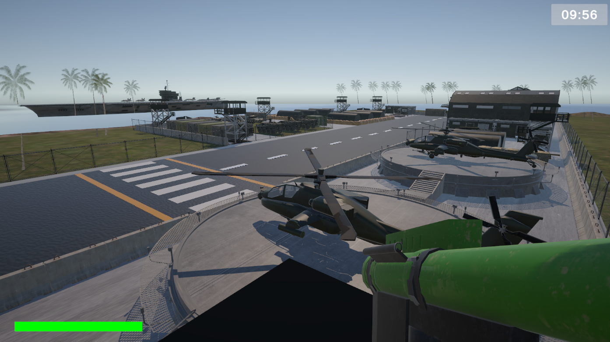
</p>

## Gameplay

### Single-player Mission

Defend the airspace as a soldier armed with an FIM-92 Stinger surface-to-air missile launcher. Three enemy aircraft approach the base, shoot them all down before they reach you.

<p align="center">
    <video src="https://github.com/user-attachments/assets/11fb41f2-3451-4c86-9235-fe4e6d2195cf" controls width="700"></video>
</p>

### 1v1 LAN Multiplayer

Asymmetric versus mode. One player operates the Stinger on the ground, the other pilots an enemy jet. Host or join over LAN with a custom lobby. First to the score limit wins, with a Golden Kill overtime mode if the timer runs out tied.

<p align="center">
    <video src="https://github.com/user-attachments/assets/cc3d2830-5088-4923-ba94-3b21d44fab7d" controls width="700"></video>
</p>

## Features

### Core Mechanics

- FIM-92 Stinger missile launcher with target lock-on system
- Guided missile that simulates heat-seeking tracking on the locked target
- Unguided fallback shot when no lock available
- Speed-based plane controller (lift, drag, and control responsiveness scale with airspeed)
- First-person camera with reticle and dynamic HUD
- Day/night cycle, ambient music, immersive environment

### Multiplayer (1v1 LAN)

- Custom lobby with host/join via IP (Unity Netcode for GameObjects)
- Server-authoritative game state with NetworkVariable synchronization
- Real-time health bars, scoreboard, kill/death tracking
- Disconnect handling (host disconnect ends match with client win, and vice versa)
- Golden Kill overtime mode when timer expires on a tie
- Network firewall manager for automatic Windows firewall rule setup

## Screenshots

<table>
  <tr>
    <td>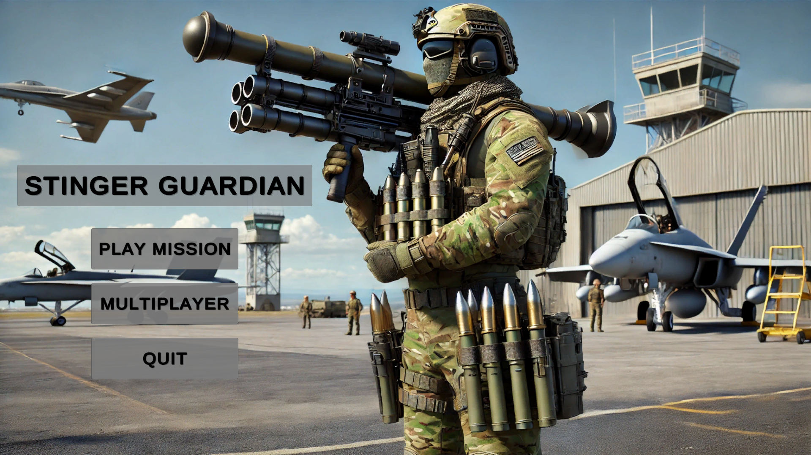</td>
    <td>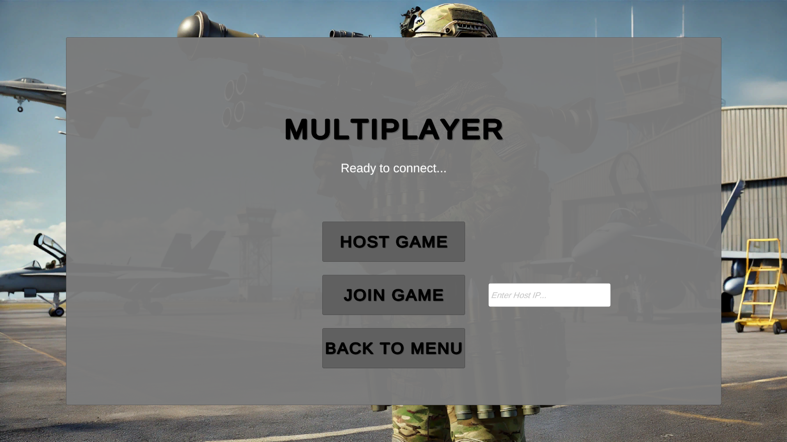</td>
  </tr>
  <tr>
    <td align="center"><sub>Main Menu</sub></td>
    <td align="center"><sub>Multiplayer Menu</sub></td>
  </tr>
  <tr>
    <td>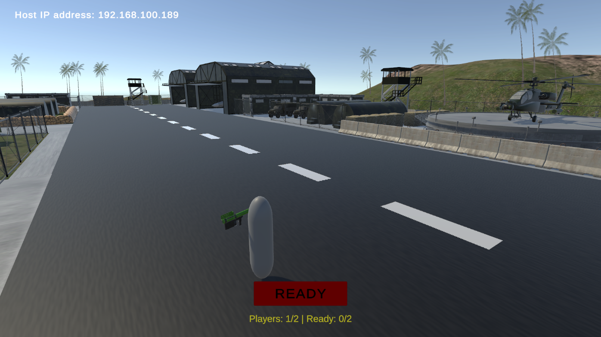</td>
    <td>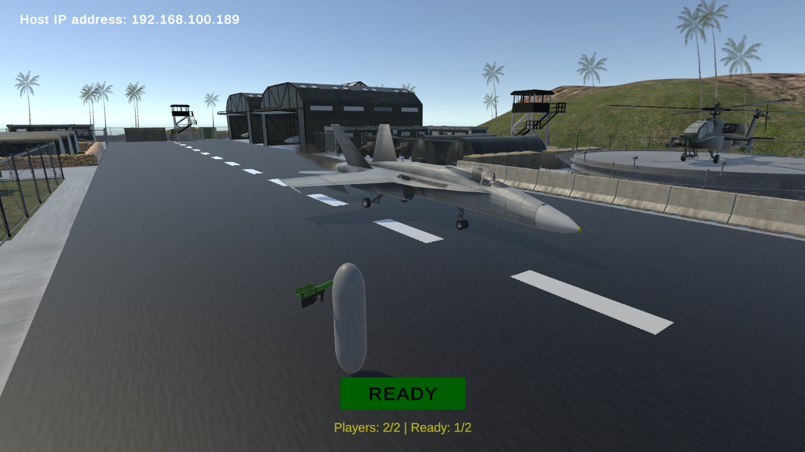</td>
  </tr>
  <tr>
    <td align="center"><sub>Empty Lobby</sub></td>
    <td align="center"><sub>Both players ready</sub></td>
  </tr>
  <tr>
    <td>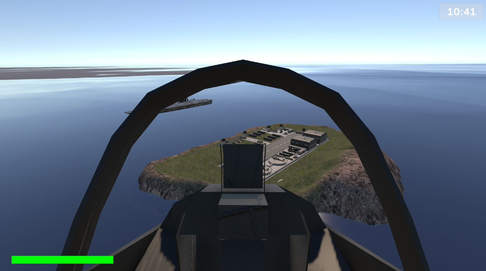</td>
    <td>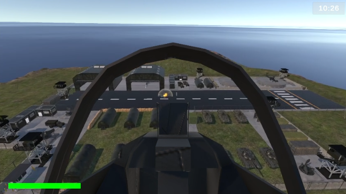</td>
  </tr>
  <tr>
    <td align="center"><sub>Jet pilot view</sub></td>
    <td align="center"><sub>Jet firing on ground target</sub></td>
  </tr>
  <tr>
    <td>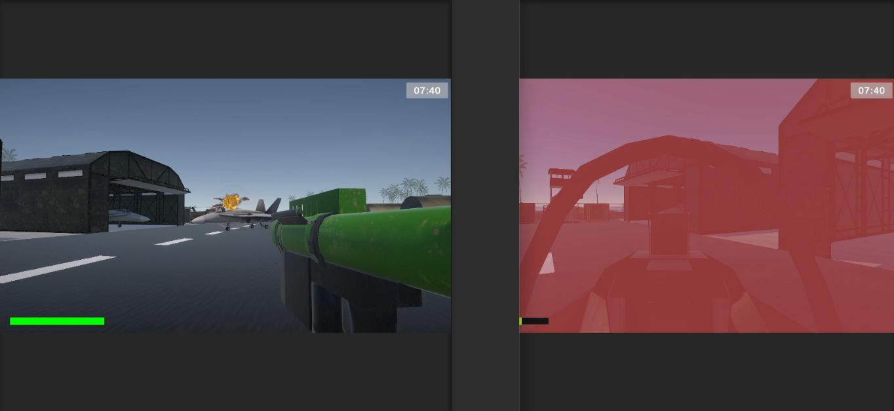</td>
    <td>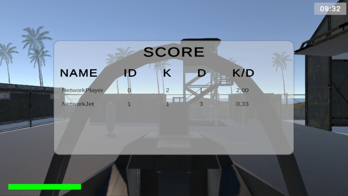</td>
  </tr>
  <tr>
    <td align="center"><sub>Stinger missile launch</sub></td>
    <td align="center"><sub>In-game scoreboard</sub></td>
  </tr>
  <tr>
    <td>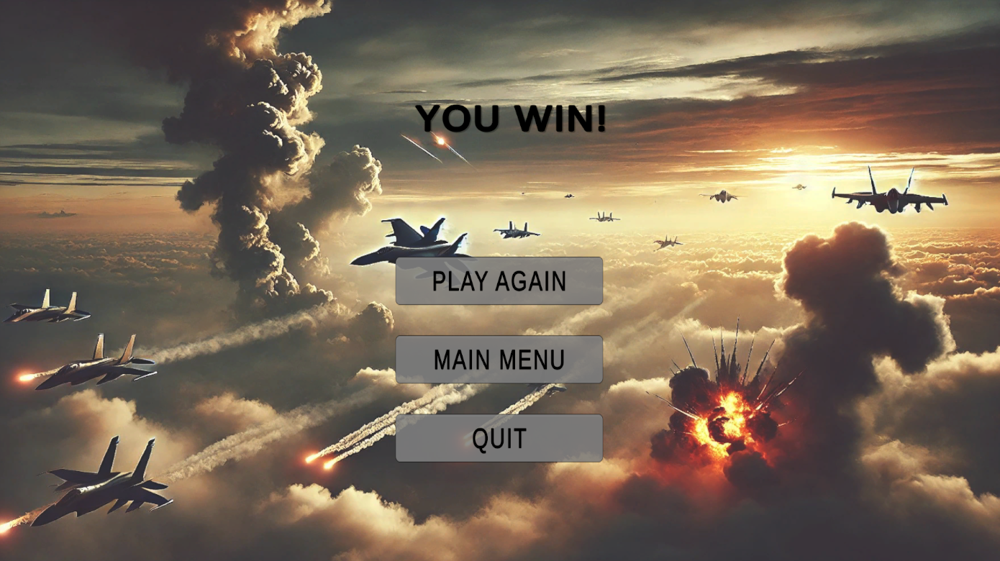</td>
    <td>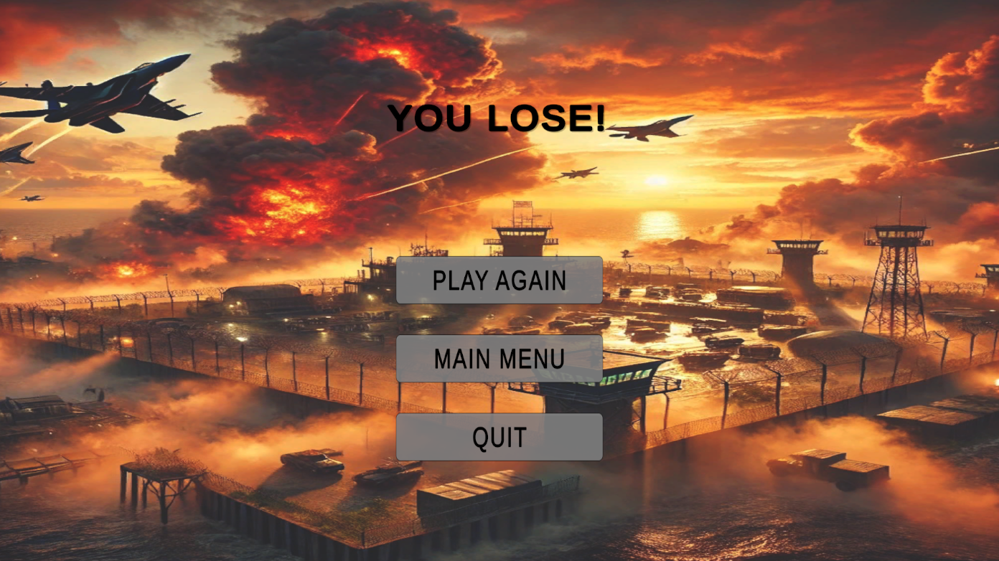</td>
  </tr>
  <tr>
    <td align="center"><sub>Victory screen</sub></td>
    <td align="center"><sub>Defeat screen</sub></td>
  </tr>
</table>

## Tech Stack

- **Engine:** Unity 2022.3.28f1 LTS (Universal Render Pipeline)
- **Language:** C# (.NET Standard 2.1)
- **Networking:** Unity Netcode for GameObjects 1.8.1
- **Transport:** Unity Transport 2.2.1
- **UI:** TextMeshPro, Unity UGUI
- **Input:** Unity Input System 1.7.0

## Project Structure

```
stinger-guardian/
├── Assets/
│   └── Scripts/
│       ├── Core/             # Input, events, network infrastructure
│       ├── Player/           # Player controller and camera
│       ├── Aircraft/         # Jet physics and flight controls
│       ├── Weapons/          # Stinger, missiles, targeting
│       ├── Enemy/            # AI for single-player mission
│       ├── UI/               # Menus, HUD, lobby UI
│       ├── Networking/       # Multiplayer game logic
│       └── Environment/      # Day/night, background music
├── Packages/                 # Unity package dependencies
├── ProjectSettings/          # Unity project configuration
├── Media/
│   ├── Screenshots/          # Game screenshots
│   └── Videos/               # Gameplay videos
├── CREDITS.md                # Third-party asset attribution
└── LICENSE                   # MIT
```

## Roadmap

Early prototype. Planned next steps:

- **Code refactor** with cleaner architecture and improved separation of concerns
- **Machine gun on the enemy jet**
- **Ammo and reload UI** for both sides (Stinger missiles, jet missiles and bullets)
- **Reload animation** for the Stinger launcher
- **Proper soldier model** to replace the current placeholder
- **Mini-map UI** showing enemy positions during combat
- **Flares on the jet** with full countermeasure logic
- **Online multiplayer** beyond the current LAN-only mode:
  - Join by code
  - Browser of available lobbies

...and more.

## Source Code Only

This repository contains source code without third-party assets (3D models, textures, audio). When cloning, scenes and prefabs will appear with missing references in Unity. The game cannot be built from this repository alone. See [CREDITS.md](CREDITS.md) for the list of original asset sources used during development.

## License

[MIT](LICENSE) © Zvonimir Kilić
